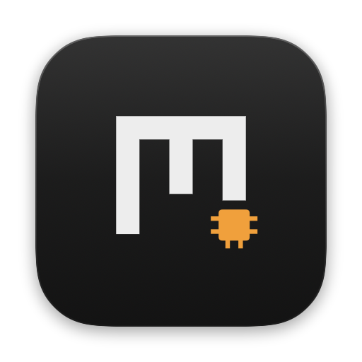
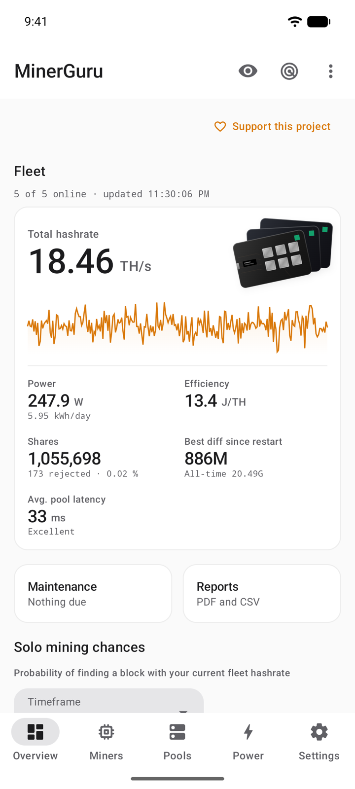
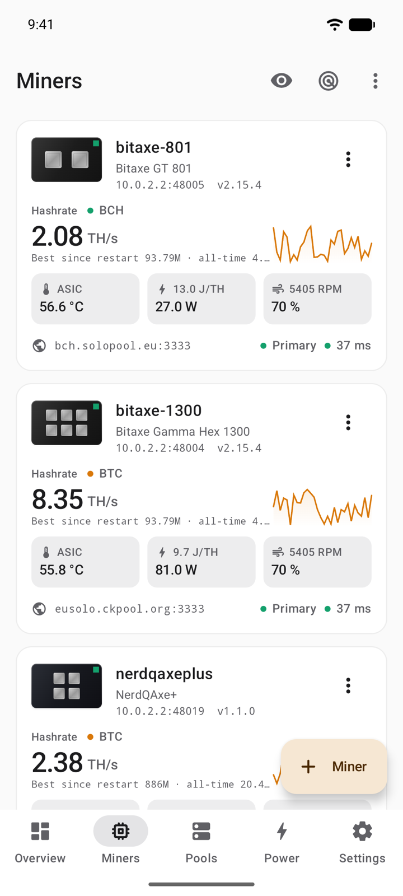
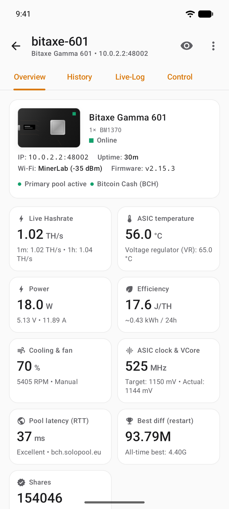

<p align="center">
  
</p>

<h1 align="center">MinerGuru for Android</h1>

<p align="center">
  <b>Your Bitaxe and NerdQAxe fleet in your pocket.</b><br>
  Find your miners, watch them, tune them, and know when one needs you.
</p>

<p align="center">
  <a href="https://github.com/GuruMeditationSoftware/minerguru-android/releases/latest/download/MinerGuru.apk"><b>Download for Android</b></a>
  &nbsp;·&nbsp;
  <a href="https://github.com/GuruMeditationSoftware/minerguru">Mac</a>
  &nbsp;·&nbsp;
  <a href="https://github.com/GuruMeditationSoftware/minerguru-windows">Windows</a>
  &nbsp;·&nbsp;
  <a href="https://minerguru.github.io">Website</a>
</p>

<p align="center">
  <sub>Android 12 or later · Free · Open source · No account</sub>
</p>

<table>
  <tr>
    <td width="33%">
      <picture>
        <source media="(prefers-color-scheme: dark)" srcset=".github/readme/android-overview-dark.png">
        
      </picture>
    </td>
    <td width="33%">
      <picture>
        <source media="(prefers-color-scheme: dark)" srcset=".github/readme/android-miners-dark.png">
        
      </picture>
    </td>
    <td width="33%">
      <picture>
        <source media="(prefers-color-scheme: dark)" srcset=".github/readme/android-detail-dark.png">
        
      </picture>
    </td>
  </tr>
  <tr>
    <td align="center"><sub>Fleet overview</sub></td>
    <td align="center"><sub>Every miner at a glance</sub></td>
    <td align="center"><sub>One miner in detail</sub></td>
  </tr>
</table>

MinerGuru talks to AxeOS and NerdOS directly over your local network. No cloud in between, no account, no tracking: just your miners and a native app built in Material You.

## Features

- **Finds your miners.** Scans your network in seconds, or add a miner by IP address or hostname.
- **Live fleet dashboard.** Total hashrate with its history, power, efficiency in J/TH, shares, best difficulty and pool latency.
- **Alerts in the background.** Battery-friendly checks every 15 minutes, or every minute when you need to know right away. Also by email through your own mail server.
- **Tune and control.** Frequency, core voltage and fan for Eco, Standard and Boost. Restart or rename with a tap. Overclocking is always at your own risk.
- **Pools.** The same pool library, slot assignment and scheduled switching as on the Mac.
- **Live log.** The miner's own log streamed live, with filter, search and sharing.
- **Solo mining odds.** Your chance of finding a block, for BTC and BCH.
- **Widgets.** Fleet in four sizes, a single miner and your solo odds on the home screen, colored by your wallpaper and kept fresh while the app is closed.
- **Maintenance and reports.** Reminders for fan cleaning, thermal paste and firmware checks; reports on uptime, energy and cost as PDF or CSV.
- **Material You.** Takes its colors from your wallpaper, follows dark mode and runs edge to edge.
- **Private by design.** Once a day MinerGuru asks GitHub for a new version, and you can turn that off.

Works with every miner running AxeOS or NerdOS, including Bitaxe Max, Ultra, Supra, Gamma, GT and Hex, NerdAxe, NerdQAxe and NerdOctaxe. Board, chip count and ASIC are detected automatically.

## Download and install

**[Download MinerGuru.apk](https://github.com/GuruMeditationSoftware/minerguru-android/releases/latest/download/MinerGuru.apk)** · Android 12 or later

1. Download the APK on your phone and open it. When Android asks, allow your browser to install unknown apps.
2. Open MinerGuru and allow access to devices on your local network, so it can find your miners.

MinerGuru is published anonymously, so Google has not verified its developer. Where Google enforces this, Android refuses the install until you allow apps from unverified developers once. The [website](https://minerguru.github.io/#download) explains the steps.

**Updates:** MinerGuru tells you when a new version is out. To get updates automatically, add `github.com/GuruMeditationSoftware/minerguru-android` in [Obtainium](https://github.com/ImranR98/Obtainium).

Every release lists its SHA-256 checksum in `SHA256SUMS.txt`. What changed: [Releases](https://github.com/GuruMeditationSoftware/minerguru-android/releases).

## MinerGuru on your other devices

| Platform | Requirements | Download |
| --- | --- | --- |
| **Android** (this repository) | Android 12 or later | [MinerGuru.apk](https://github.com/GuruMeditationSoftware/minerguru-android/releases/latest/download/MinerGuru.apk) |
| [**Mac**](https://github.com/GuruMeditationSoftware/minerguru) | macOS 14 or later, Apple Silicon | [MinerGuru.dmg](https://github.com/GuruMeditationSoftware/minerguru/releases/latest/download/MinerGuru.dmg) |
| [**Windows**](https://github.com/GuruMeditationSoftware/minerguru-windows) | Windows 11, x64 or Arm | [x64](https://github.com/GuruMeditationSoftware/minerguru-windows/releases/latest/download/MinerGuru-x64.exe) · [Arm64](https://github.com/GuruMeditationSoftware/minerguru-windows/releases/latest/download/MinerGuru-arm64.exe) |

## Build from source

You need JDK 21 and the Android SDK. Android Studio brings both.

```bash
git clone https://github.com/GuruMeditationSoftware/minerguru-android.git
```

```bash
cd minerguru-android
./gradlew assembleDebug testDebugUnitTest   # debug app and unit tests
./gradlew installDebug                      # onto a connected phone or emulator
```

The debug app has its own package name (`app.minerguru.dev`) and installs next to the official one. Releases are signed with the maintainer's key, so an APK you build yourself cannot update the official app.

To test without hardware, start the simulated miners from the [Mac repository](https://github.com/GuruMeditationSoftware/minerguru) (`python3 MockMiners/mock_miner.py --host 0.0.0.0`) and add them by your computer's address, from port 48001. The emulator reaches your computer at `10.0.2.2`.

Developer documentation, in German: [docs/ENTWICKLUNG.md](docs/ENTWICKLUNG.md) and [docs/ARCHITEKTUR.md](docs/ARCHITEKTUR.md). What all three apps share is in [GRUNDLAGEN.md](https://github.com/GuruMeditationSoftware/minerguru/blob/main/docs/GRUNDLAGEN.md) of the Mac repository.

## Support the project

MinerGuru is free and shows no ads. If it keeps your miners happy, a few sats keep the updates coming.

<table>
  <tr>
    <td align="center"><br><b>Bitcoin</b></td>
    <td align="center"><br><b>Bitcoin Cash</b></td>
  </tr>
</table>

**BTC**

```text
bc1qc6xpuwkys8jsjt439tfw2eu3fctkx7ad0hkehe
```

**BCH**

```text
bitcoincash:qruvqq2x9vyd9gykre058r4lda4gulpres33nr9aml
```

## Feedback and contributing

Found a bug or have an idea? Open an [issue](https://github.com/GuruMeditationSoftware/minerguru/issues) in the Mac repository. It collects feedback for all three apps. Pull requests are welcome, see [CONTRIBUTING.md](CONTRIBUTING.md).

## License

MinerGuru is open source under the [MIT License](LICENSE.txt). The libraries inside the app keep their own licenses, see [THIRD-PARTY-NOTICES.txt](app/src/main/assets/THIRD-PARTY-NOTICES.txt).
