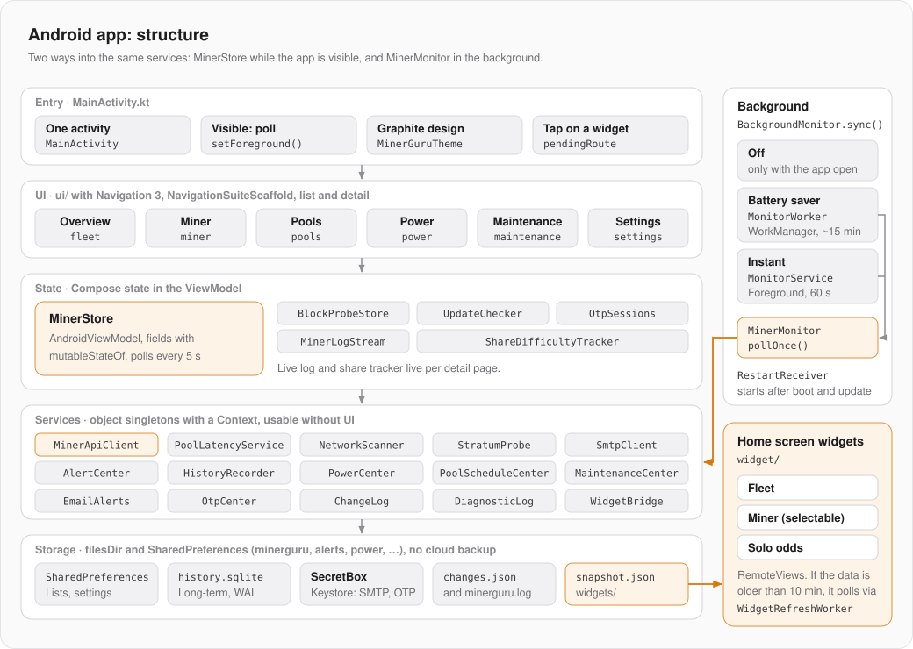
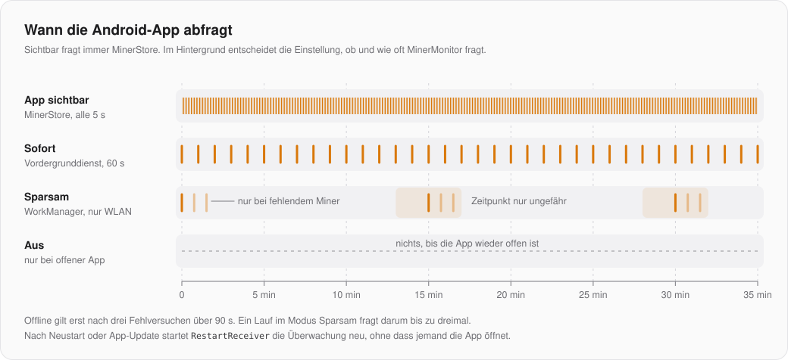

# Android app: architecture

What all three apps have in common (miner API, poll cycle, write path, watchdog, mock miners) is in the Mac repository under [`docs/FUNDAMENTALS.md`](https://github.com/GuruMeditationSoftware/minerguru/blob/main/docs/FUNDAMENTALS.md). It also has the table of which class here matches which Mac class. This page describes only the Android app.

| | |
|---|---|
| Language, UI | Kotlin, Jetpack Compose, Material 3, Navigation 3 |
| Android | `minSdk` 31 (Android 12), `targetSdk` and `compileSdk` 37, Java 21 |
| Package | `app.minerguru`, debug build `app.minerguru.dev` |
| Libraries | OkHttp (REST and WebSocket), WorkManager, ZXing (QR codes), otherwise only AndroidX |
| Build | one module `:app`, release with R8 and resource shrinking |

## Structure



| Package | Contents |
|---|---|
| `app.minerguru` | `MainActivity` |
| `ui/` | Compose UI: `MinerGuruMainScreen` (navigation), one subpackage per area, shared building blocks in `components/`, colors in `theme/` |
| `service/` | `MinerStore`, the services, background monitoring |
| `model/` | Value types and pure logic: telemetry, hardware, watchdog, tariffs, change log, language |
| `widget/` | Home screen widgets and their snapshot |

## Entry point and navigation

There is a single activity. `MainActivity` installs the splash screen, turns on edge-to-edge and reports through the lifecycle whether the app is visible (`onStart`/`onStop` → `MinerStore.setForeground`). Only while it is visible does `MinerStore` poll at the set interval.

`MinerGuruMainScreen` builds the navigation with Navigation 3: destinations are entries of the `sealed interface Route` (overview, miners, pools, power, settings, maintenance, reports, miner detail, add miner). `NavigationSuiteScaffold` picks a bottom bar or a side rail depending on the window size, and `ListDetailSceneStrategy` shows list and detail side by side on large screens. Back gestures run as predictive back.

Tapping a widget starts the activity with the extra `app.minerguru.route`; `MinerStore.pendingRoute` holds the destination until the navigation has opened it.

## State

`MinerStore` is an `AndroidViewModel`. Its state is Compose state (`mutableStateOf`); the UI reads it directly and redraws when it changes. It owns the miner list, settings, scan, pool library and the drafts of the controls, plus `BlockProbeStore` and `UpdateChecker`. The live log (`MinerLogStream`) and the share tracker live only while a detail page is open (`remember` in `MinerDetailScreen`).

Questions to the user (one-time code, confirmation before a write) run as state: `MinerStore` sets an `OtpRequest` or `WriteRequest`, the UI shows the dialog and reports the answer back.

## Services without UI

Almost all services are `object` singletons that receive a `Context` instead of hanging off the ViewModel: `AlertCenter`, `HistoryRecorder`, `PowerCenter`, `PoolScheduleCenter`, `MaintenanceCenter`, `EmailAlerts`, `OtpCenter`, `WidgetBridge` and the network clients. That way the visible app and the background monitoring use the same code. Shared state therefore lives in files and SharedPreferences, not in the ViewModel's memory. When the app returns to the foreground, `MinerStore` reloads what the background may have changed in the meantime, such as the miners' power states.

## Background monitoring



`BackgroundMonitor.sync()` sets up what the setting asks for. It is called when the setting changes and every time the app returns to the foreground, so that a service the system stopped starts again.

| Mode | Technique | Interval |
|---|---|---|
| Off | nothing | only while the app is open |
| Battery saver | `MonitorWorker` through WorkManager, only on unmetered networks (Wi-Fi) | about every 15 min, on failure two retries 45 s apart |
| Instant | `MonitorService`, a foreground service of type `connectedDevice` with a persistent notification | every minute |

Both call `MinerMonitor.pollOnce()`: it reads the saved miner list, polls and hands the result to the history, widgets, watchdog, email and schedules. `RestartReceiver` restarts the monitoring after a device restart or an app update. Without permission for notifications the monitoring stays off.

## Storage

| Where | What |
|---|---|
| SharedPreferences `minerguru` | Miner list, pools, settings, language |
| SharedPreferences `alerts`, `power`, `poolSchedules`, `maintenance`, `email`, `otp`, `history` | State of the respective services |
| `history.sqlite` | Long-term history, WAL mode, all access synchronized (ViewModel, worker and service write) |
| `SecretBox` | AES-GCM with a key in the Android Keystore, for the SMTP password and one-time code sessions |
| `files/` | `changes.json`, `minerguru.log`, `widgets/snapshot.json` |

`allowBackup` is off: nothing goes into the cloud backup.

## Permissions

| Permission | Purpose |
|---|---|
| `ACCESS_LOCAL_NETWORK` | needed from Android 17 to reach miners on the LAN; requested at runtime and checked on every return |
| `POST_NOTIFICATIONS` | Alerts |
| `FOREGROUND_SERVICE`, `FOREGROUND_SERVICE_CONNECTED_DEVICE`, `CHANGE_NETWORK_STATE` | Instant mode |
| `RECEIVE_BOOT_COMPLETED` | Monitoring after a restart |
| `usesCleartextTraffic` | the miners only speak HTTP |

## Widgets

Fleet (four sizes, from about 250 dp of height with a list of all miners), miner (chosen when placing it, in `MinerWidgetConfigActivity`) and solo odds. Built with `RemoteViews` and a size map, without Glance.

- `WidgetBridge.publish` writes `files/widgets/snapshot.json` after every poll (app or background) and redraws when a state changes, otherwise at most once a minute.
- If the data is older than 10 min, the widget starts `WidgetRefreshWorker` (Wi-Fi only). If no miner answers, the old data stays with its time.
- Colors come from the system palette (Material You), the corner radius from `system_app_widget_background_radius`. On Samsung (`Build.MANUFACTURER`) there is a neutral One UI card; testable in the emulator with `adb shell setprop debug.minerguru.skin ONE_UI` (debug only).

## Build and test

```bash
./gradlew assembleDebug testDebugUnitTest
```

```bash
./gradlew assembleRelease
```

The unit tests (JUnit 4) check all 24 variants from `src/test/resources/variants`, a copy of `MinerGuru/MockMiners/variants`, and the Stratum captures. For tests against running mock miners in the emulator: the Mac is reachable from the emulator at `10.0.2.2`.

The update notice asks `BuildConfig.UPDATE_URL`. In a debug build the address can be redirected for tests: `./gradlew installDebug -PupdateUrl=http://10.0.2.2:8123/latest`.

## Release

Raise `versionName` and `versionCode` in `app/build.gradle.kts`, then run `scripts/release.sh`. The script builds the release APK, checks that it is signed with the right key (`CN=MinerGuru`, pinned SHA-256), searches for personal traces and creates `dist/upload/`. Only the maintainer has the key and passwords (`keystore.properties`, never in the published source). Without them you get an unsigned release APK.

## Pitfalls

- **Always run the release build yourself**, not just debug: R8 once removed the constructor of WorkManager's Room database, and the app crashed on start. The rule against it is in `proguard-rules.pro`.
- If a real device is connected next to the emulator, `installDebug` installs on both. Set `ANDROID_SERIAL` to the emulator.
- `<View>` is not allowed in `RemoteViews`; placeholders are `FrameLayout`s.
- `setWidgetPreview` is throttled per hour. After that the widget picker shows the XML layout, which is why its sample texts exist as resources in both languages.
- "Force stop" clears the widgets' PendingIntents until the next redraw.
- Texts live in `res/values/strings.xml` (English) and `res/values-de/strings.xml` (German). Code reads them with `tr(R.string.key)`, `tr(R.string.key, value)` and `trp(R.plurals.key, n)`, not `stringResource`: the app language can differ from the device's, and services, workers and widgets need texts outside Compose. `Lang.english` is Compose state; switching the language redraws everything at once. `MinerGuruApp` connects the resources at process start.
- Placeholders are `%1$s`, `%2$s`; a literal `%` in a text with placeholders is `%%`. Keys must not be Java or Kotlin keywords (`continue_label`, `when_label`). Unit tests read the XML files through `XmlTexts` (`useGermanTexts()`), so they need no Robolectric.
