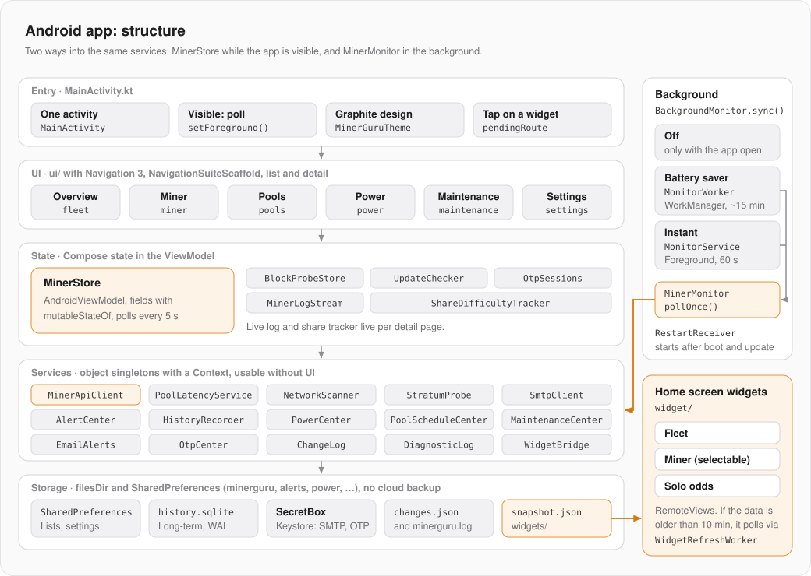
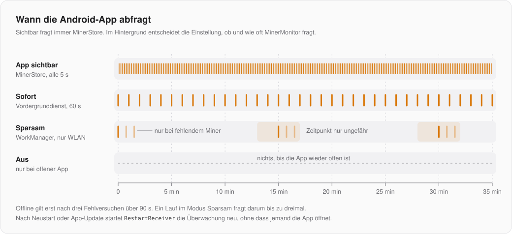

# Android-App: Architektur

Was alle drei Apps gemeinsam haben (Miner-API, Abfragerunde, Schreibweg, Wächter, Mock-Miner), steht im Mac-Repo unter `MinerGuru/docs/GRUNDLAGEN.md`. Dort gibt es auch die Tabelle, welche Klasse hier welcher Mac-Klasse entspricht. Diese Seite beschreibt nur die Android-App.

| | |
|---|---|
| Sprache, Oberfläche | Kotlin, Jetpack Compose, Material 3, Navigation 3 |
| Android | `minSdk` 31 (Android 12), `targetSdk` und `compileSdk` 37, Java 21 |
| Paket | `app.minerguru`, Debug-Build `app.minerguru.dev` |
| Bibliotheken | OkHttp (REST und WebSocket), WorkManager, ZXing (QR-Codes), sonst nur AndroidX |
| Build | ein Modul `:app`, Release mit R8 und Ressourcen-Schrumpfung |

## Aufbau



| Paket | Inhalt |
|---|---|
| `app.minerguru` | `MainActivity` |
| `ui/` | Compose-Oberfläche: `MinerGuruMainScreen` (Navigation), je Bereich ein Unterpaket, gemeinsame Bausteine in `components/`, Farben in `theme/` |
| `service/` | `MinerStore`, die Dienste, Hintergrund-Überwachung |
| `model/` | Werttypen und reine Logik: Telemetrie, Hardware, Wächter, Tarife, Änderungsprotokoll, Sprache |
| `widget/` | Homescreen-Widgets und ihr Schnappschuss |

## Einstieg und Navigation

Es gibt eine einzige Aktivität. `MainActivity` installiert den Splash-Screen, schaltet Edge-to-Edge ein und meldet über den Lifecycle, ob die App sichtbar ist (`onStart`/`onStop` → `MinerStore.setForeground`). Nur solange sie sichtbar ist, fragt `MinerStore` im eingestellten Intervall ab.

`MinerGuruMainScreen` baut die Navigation mit Navigation 3: Ziele sind Einträge des `sealed interface Route` (Übersicht, Miner, Pools, Strom, Einstellungen, Wartung, Berichte, Minerdetail, Miner hinzufügen). `NavigationSuiteScaffold` wählt je nach Fenstergröße Leiste unten oder Rail an der Seite, `ListDetailSceneStrategy` zeigt auf großen Bildschirmen Liste und Detail nebeneinander. Zurück-Gesten laufen als Predictive Back.

Ein Tipp aufs Widget startet die Aktivität mit dem Extra `app.minerguru.route`; `MinerStore.pendingRoute` hält das Ziel, bis die Navigation es geöffnet hat.

## Zustand

`MinerStore` ist ein `AndroidViewModel`. Sein Zustand sind Compose-States (`mutableStateOf`), die Oberfläche liest sie direkt und zeichnet neu, wenn sie sich ändern. Er besitzt Miner-Liste, Einstellungen, Scan, Pool-Bibliothek und Entwürfe der Steuerung, dazu `BlockProbeStore` und `UpdateChecker`. Live-Log (`MinerLogStream`) und Share-Tracker leben nur, solange eine Detailseite offen ist (`remember` in `MinerDetailScreen`).

Rückfragen an den Nutzer (Einmalcode, Bestätigung vor dem Schreiben) laufen als Zustand: `MinerStore` setzt eine `OtpRequest` bzw. `WriteRequest`, die Oberfläche zeigt den Dialog und meldet die Antwort zurück.

## Dienste ohne Oberfläche

Fast alle Dienste sind `object`-Singletons, die einen `Context` bekommen, statt am ViewModel zu hängen: `AlertCenter`, `HistoryRecorder`, `PowerCenter`, `PoolScheduleCenter`, `MaintenanceCenter`, `EmailAlerts`, `OtpCenter`, `WidgetBridge` und die Netz-Clients. So nutzen die sichtbare App und die Hintergrund-Überwachung denselben Code. Gemeinsamer Zustand liegt deshalb in Dateien und SharedPreferences, nicht im Speicher des ViewModels. Nach der Rückkehr in den Vordergrund liest `MinerStore` deshalb neu ein, was der Hintergrund inzwischen geändert haben kann, etwa die Strom-Zustände der Miner.

## Hintergrund-Überwachung



`BackgroundMonitor.sync()` richtet ein, was die Einstellung verlangt. Es wird beim Ändern der Einstellung und bei jeder Rückkehr in den Vordergrund aufgerufen, damit ein vom System beendeter Dienst wieder startet.

| Modus | Technik | Takt |
|---|---|---|
| Aus | nichts | nur bei offener App |
| Sparsam | `MonitorWorker` über WorkManager, nur in nicht getakteten Netzen (WLAN) | etwa alle 15 min, bei Ausfall zwei Wiederholungen im Abstand von 45 s |
| Sofort | `MonitorService`, Vordergrunddienst vom Typ `connectedDevice` mit dauerhafter Mitteilung | jede Minute |

Beide rufen `MinerMonitor.pollOnce()`: lesen die gespeicherte Miner-Liste, fragen ab und reichen das Ergebnis an Verlauf, Widgets, Wächter, E-Mail und Zeitpläne. `RestartReceiver` startet die Überwachung nach einem Neustart des Geräts oder einem App-Update. Ohne erlaubte Mitteilungen bleibt die Überwachung aus.

## Speicher

| Wo | Was |
|---|---|
| SharedPreferences `minerguru` | Miner-Liste, Pools, Einstellungen, Sprache |
| SharedPreferences `alerts`, `power`, `poolSchedules`, `maintenance`, `email`, `otp`, `history` | Zustand der jeweiligen Dienste |
| `history.sqlite` | Langzeit-Verlauf, WAL-Modus, alle Zugriffe synchronisiert (ViewModel, Worker und Dienst schreiben) |
| `SecretBox` | AES-GCM mit Schlüssel im Android Keystore, für SMTP-Passwort und Einmalcode-Sitzungen |
| `files/` | `changes.json`, `minerguru.log`, `widgets/snapshot.json` |

`allowBackup` ist aus: Nichts geht in die Cloud-Sicherung.

## Berechtigungen

| Berechtigung | Wofür |
|---|---|
| `ACCESS_LOCAL_NETWORK` | ab Android 17 nötig, um Miner im LAN zu erreichen; wird zur Laufzeit erfragt und bei jeder Rückkehr geprüft |
| `POST_NOTIFICATIONS` | Warnungen |
| `FOREGROUND_SERVICE`, `FOREGROUND_SERVICE_CONNECTED_DEVICE`, `CHANGE_NETWORK_STATE` | Modus Sofort |
| `RECEIVE_BOOT_COMPLETED` | Überwachung nach Neustart |
| `usesCleartextTraffic` | die Miner sprechen nur HTTP |

## Widgets

Flotte (vier Größen, ab etwa 250 dp Höhe mit Liste aller Miner), Miner (Auswahl beim Platzieren in `MinerWidgetConfigActivity`) und Solo-Chance. Gebaut mit `RemoteViews` und einer Größen-Map, ohne Glance.

- `WidgetBridge.publish` schreibt nach jeder Abfrage (App oder Hintergrund) `files/widgets/snapshot.json` und zeichnet neu bei Zustandswechsel, sonst höchstens jede Minute.
- Sind die Daten älter als 10 min, startet das Widget `WidgetRefreshWorker` (nur WLAN). Antwortet kein Miner, bleibt der alte Stand mit Uhrzeit stehen.
- Farben kommen aus der Systempalette (Material You), Eckenradius aus `system_app_widget_background_radius`. Auf Samsung (`Build.MANUFACTURER`) gibt es eine neutrale One-UI-Karte; im Emulator testbar mit `adb shell setprop debug.minerguru.skin ONE_UI` (nur Debug).

## Bauen und testen

```bash
./gradlew assembleDebug testDebugUnitTest
```

```bash
./gradlew assembleRelease
```

Die Unit-Tests (JUnit 4) prüfen alle 24 Varianten aus `src/test/resources/variants`, einer Kopie von `MinerGuru/MockMiners/variants`, und die Stratum-Mitschnitte. Für Tests gegen laufende Mock-Miner im Emulator: Der Mac ist aus dem Emulator unter `10.0.2.2` erreichbar.

Der Update-Hinweis fragt `BuildConfig.UPDATE_URL`. Im Debug-Build lässt sich die Adresse für Tests umbiegen: `./gradlew installDebug -PupdateUrl=http://10.0.2.2:8123/latest`.

## Release

`versionName` und `versionCode` in `app/build.gradle.kts` erhöhen, dann `scripts/release.sh`. Das Skript baut das Release-APK, prüft, dass es mit dem richtigen Schlüssel (`CN=MinerGuru`, festgelegter SHA-256) signiert ist, sucht nach persönlichen Spuren und legt `dist/upload/` an. Schlüssel und Passwörter hat nur der Maintainer (`keystore.properties`, nie im veröffentlichten Quellcode). Ohne sie entsteht ein unsigniertes Release-APK.

## Stolperstellen

- **Release-Build immer selbst starten**, nicht nur Debug: R8 hat einmal den Konstruktor der Room-Datenbank von WorkManager entfernt, die App stürzte beim Start ab. Die Regel dagegen steht in `proguard-rules.pro`.
- Ist neben dem Emulator ein echtes Gerät angeschlossen, installiert `installDebug` auf beiden. `ANDROID_SERIAL` auf den Emulator setzen.
- In `RemoteViews` ist `<View>` verboten; Platzhalter sind `FrameLayout`s.
- `setWidgetPreview` ist pro Stunde gedrosselt. Danach zeigt die Widget-Auswahl das XML-Layout, deshalb stehen dessen Beispieltexte als Ressourcen in beiden Sprachen bereit.
- „Beenden erzwingen“ löscht die PendingIntents der Widgets bis zum nächsten Neuzeichnen.
- Neue Texte direkt als `L("deutsch", "english")` schreiben. `Lang.english` ist Compose-State, ein Sprachwechsel zeichnet sofort alles neu.
